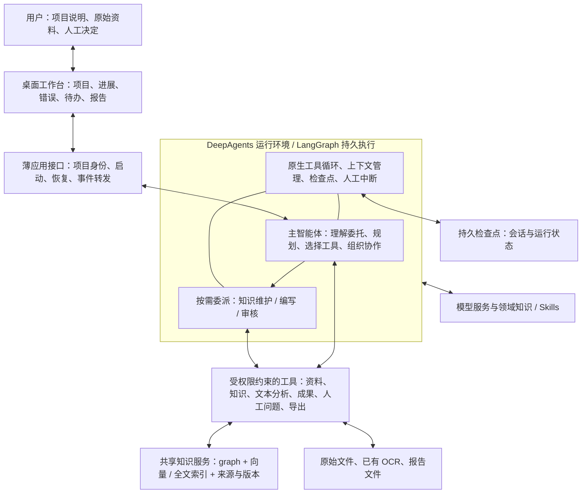

# 报告智能体系统架构设计

日期：2026-09-27。状态：设计提案，待用户审阅，不是已部署架构。

本次目标：利用已有工程成果资料，形成范围明确、内容有依据、可审核的汇编报告。
不是重新开展设计计算，不自动工程签发。系统应适应不同项目和行业，避免把领域判断固化为代码分支。

本次仅设计；不修改应用、安装依赖、迁移数据、部署、调用付费模型或恢复旧任务。
当前新项目仍为 ADK 原型；120 项历史自动测试不构成 DeepAgents 方案或真实报告质量的验证。

## 1. 核心架构

采用 **DeepAgents 原生运行机制 + 目标驱动的智能体 + 共享知识服务 + 少量业务工具**。
Google agent design patterns 是设计参考，不是选择 Google ADK 的依据。

图中是责任与数据连接，不是必须依次执行的业务流程；W 不是固定数量的常驻专家。

## 2. 三类责任

| 层次 | 负责 | 不负责 |
| --- | --- | --- |
| DeepAgents / LangGraph | 模型与工具循环、委派、上下文管理、会话检查点、人工中断与恢复、事件流 | 判断工程资料正确性、自动提供本项目事实图谱 |
| 智能体 | 判断文档用途、范围和资料相关性；规划有意义的工作；选择工具、复用成果、判断修订影响；编写与审核 | 改变服务端身份和权限、自行裁定原始资料冲突、把缺失信息猜成事实 |
| 工具及基础设施 | 执行查询与写入、生成 ID、保留来源版本、校验权限、事务和幂等、转换文件、展示状态 | 用固定成果类型或模板章节代替业务判断、替智能体决定所有微步骤 |

业务推理主要由 agent 完成；确定性校验不为“智能化”而改成模型调用。
框架提供机制不等于已完成配置，更不等于外部数据库写入天然恰好执行一次。

## 3. 智能体组织

一个主智能体对最终报告负责：先理解委托和文档用途，再根据观察决定完成方式。
它可以直接完成用途分析和编制计划，也可以在复杂任务中委派；不要求生成独立用途文件才能规划。

提供三类可选委派能力，不规定全部资料都要经过三类子智能体：

| 能力身份 | 成果责任与权限 | 何时调用 |
| --- | --- | --- |
| 知识维护 | 从原文提炼事实、关联对象、维护共享知识；可修订其负责的知识记录 | 已有知识不足，或需修订共享资料时 |
| 报告编写 | 读取共享知识及必要原文，形成报告或章节；不能改写上游事实 | 主智能体按成果规模安排编写工作时 |
| 报告审核 | 读取准确版本报告与必要依据，输出问题或审核结论；不改原文、知识及报告正文 | 对拟交付报告进行最终审核，或对明确修订点复核时 |

主智能体可以承担编写职责，但该写入仍受“不能覆盖上游知识”的权限约束。
最终审核必须由与该草稿生产过程隔离的审核执行承担；不是作者自称审核通过。
生产责任绑定到稳定的逻辑身份和成果，不绑定到某次临时子智能体实例。
主智能体安排责任方修订，不通过“管理员万能写入”绕过归属。

行业差异通过专家指令、领域参考资料和必要专业工具提供。通用运行层不写交通、建筑等行业条件分支。
切换行业通常不改运行层；新行业若需要新的解析格式或专业计算，仍须补充对应工具，不能承诺只换一句提示词就具备专业能力。

### 提示词组织

每个角色只说明目标、负责的成果、权限和必须遵守的边界。具体项目要求作为任务上下文；工具能力由工具说明提供；领域知识按需读取。
不叠加重复的阶段提示，不在多个角色中复制同一份资料核查任务。文本提取、总结、比对是可调用的 LLM 工具，不自动成为新智能体。
共同安全边界必须实际执行，但不把全部领域规则强塞进每个角色的提示词。

## 4. 框架复用清单

下表是基于官方文档的设计映射，尚未在本项目运行验证；实施前选定并锁定兼容版本。

| 所需能力 | 优先复用 | 本项目只补什么 |
| --- | --- | --- |
| 行动循环和工具反馈 | DeepAgents agent harness | 模型适配、工具注册及少量错误语义转换，不另写调度循环 |
| 按需委派 | 原生 subagents / task 能力 | 角色描述、授权工具、成果地址，不另建专家流程引擎 |
| 计划及进度 | 原生任务规划能力，按所选版本启用 | 将实际计划和事件展示给用户，不规定任务数量 |
| 上下文管理 | 原生摘要、工具结果卸载、子任务上下文隔离 | 原始资料和正式成果独立保存，不以对话摘要代替证据 |
| 中断恢复 | LangGraph 持久 checkpointer | 项目到 thread 的关联、恢复接口和外部写回执 |
| 人工处理 | 原生 interrupt / resume | 保存问题和人工决定、GUI 表单；不另建一套暂停状态机 |
| 文件与共享存储接入 | 原生 backend、store、工具扩展接口 | 项目命名空间、知识服务及生产者权限 |
| 重试与故障 | 所选版本的中间件及模型集成能力 | 确认统一策略，避免 SDK 与外层多重重试；未知写入结果先核对回执 |
| 可观察性 | 原生事件流及运行状态 | 精简 GUI、必要审计，不复制一个权威运行状态源 |

文档依据：[DeepAgents 总览](https://docs.langchain.com/oss/python/deepagents/overview)、[子智能体](https://docs.langchain.com/oss/python/deepagents/subagents)、[人工介入](https://docs.langchain.com/oss/python/deepagents/human-in-the-loop)、[LangGraph 持久化](https://docs.langchain.com/oss/python/langgraph/persistence)。
原生能力的具体默认值、串行设置、恢复粒度和 GLM 工具调用适配仍需版本级验证；不能用“框架支持”代替该验证。
原生同步委派不等于串行保证；同轮多个 task 可能并行。初版需单独配置并验证串行执行约束，优先采用原生能力或最薄的工具并发限制，不因此另造任务队列和调度器。

## 5. Graph 共享知识服务

### 数据职责

graph 是全体专家共同使用的知识基础设施，不是编制报告必须先完成的阶段。
所有有用资料应可在共享平台定位和复用；不要求所有原文先变成细粒度三元组。
原文和 OCR 完整保留，实体、事实、关系、资料用途与派生总结按需要建立索引，并随工作持续补充。

| 信息 | 保存方式与意义 |
| --- | --- |
| 原始资料及版本 | 原文件 / OCR、文档标识、版本、页码或段落位置；原件不可被模型改写 |
| 项目事实与实体关系 | 内容、对象、来源、适用条件、生产责任方；模型提取不等于事实已经核实 |
| 用途及派生总结 | 保留解释、报告范围及依据，不能覆盖原始事实或自动视作新事实 |
| 计划、正文、审核及问题 | 作为可检索共享成果，保留版本与责任；审核意见与正文分开 |
| 采用关系 | 哪份成果实际采用哪一版资料或知识；不要求词级依赖，不由搜索命中自动推断 |

实体同一性、同义词、适用性和冲突影响由 agent 判断。程序负责候选检索与保存经判断建立的关系，不擅自按相似度合并事实。
来源定位以文档、页、段落或资料片段为单位；稳定 ID 由程序提供，不要求模型为每个词维护编号集合。

### 对智能体开放的能力

以下是工具职责草案，不是强制调用顺序，也不承诺最终函数名称：

| 工具能力 | 输入意图 | 返回内容 / 边界 |
| --- | --- | --- |
| 知识检索 | 用自然语言找事实、总结或成果；可限定范围和版本 | 向量 / 全文结果、来源、状态及继续读取位置；无命中不等于缺资料 |
| 关系遍历 | 从已知对象沿指定关系扩展 | 相关事实、来源及关系路径；说明深度、分页与未返回范围 |
| 原文读取 | 按来源位置读取必要上下文 | 原文片段、准确版本与定位；保留全文入口 |
| 知识维护 | 新增事实/关系，修订或撤销本人负责的记录 | 写入回执、新版本及原版本引用；不向模型开放任意数据库语句 |
| 文本分析 | 指定资料与具体问题 | 分析及限制；无隐式业务写入、不递归派专家 |
| 成果提交与读取 | 保存或使用计划、正文、审核等成果 | 版本、生产者、明确采用的来源；不检查固定成果类型链 |
| 纠错及人工问题 | 说明上游成果错误，或原始资料冲突/缺失 | 责任方反馈或人工待办；系统故障单独显示 |
| 报告导出 | 指定已保存报告版本 | Word 文件及该版本审核状态；生成文件不等于工程签发 |

所有工具在服务端从会话取得项目身份，权限由服务端绑定当前任务和成果生产归属；委派不能扩权，不能相信模型传入的身份。向量候选、图遍历以及后续引用解析均不得跨项目泄露。
写权限仅给相应生产责任方；编写与审核只读上游。删除采用撤销/失效和保留历史，不物理抹除已被引用内容。
不开放任意 Shell 或数据库凭证绕过这些工具；框架 filesystem 权限不能替代自定义数据库工具的授权校验。

### 建议技术选型

初版建议使用 **Neo4j 作为事实、关系和成果元数据的主存储，并使用其全文及向量索引**，避免同时维护独立图数据库与向量数据库的业务同步。
原始二进制和导出文件保存在项目文件目录；LangGraph 使用独立的持久 SQLite checkpointer 管理运行状态。
这是单机原型建议，不是已安装配置；不新增 Redis、消息队列、分布式调度器或多套业务状态机。

Neo4j 文档提供[向量索引](https://neo4j.com/docs/cypher-manual/current/indexes/semantic-indexes/vector-indexes/)和[全文索引](https://neo4j.com/docs/cypher-manual/current/indexes/semantic-indexes/full-text-indexes/)能力；实际版本/版本许可、项目过滤、中文召回和本机资源须在小样本验证。
嵌入模型是单独依赖，尚未选定；不得假定 GLM 聊天接口提供 embedding。选定后固定模型版本和维度，保留索引版本，验证中文同义表达召回。
是否使用本地或云 embedding，须结合实际资料的数据边界及调用授权；本设计不授权向新供应商发送资料。

运行检查点、业务知识和原文件具有不同职责，不保存同一份权威状态到三处。文件先以不可变内容保存，再登记图中引用；业务写与其幂等回执同事务提交。
LangGraph Store 只在确需跨线程记忆时引入；不为“用全框架功能”再复制一份项目事实和成果库。
嵌入失败、图写入失败和解析失败如实显示，可从对应操作恢复，不能伪装为原文没有信息。

## 6. 一次执行如何开展

用户提供项目说明与资料后，主智能体读取可用资料目录、用途认识、已有成果及未解决问题。
它判断要达成的成果和所需工作，优先复用；可以读取原文、查 graph、调用分析工具或委派知识整理，然后安排编写和准确版本审核。
这些是允许的行动，不是代码固定的路线：资料足够时可以直接编写，不必为提交草稿另造材料总结；同一任务可以合并有意义的工作。

用途必须理解，但不必须调用“用途专家”；计划可以由主智能体维护，不必须另起“规划专家”。
代码不要求父章重复列出所有子节的编号合集，不固定章节深度或任务数量。用户明确规定的报告内容仍必须落实。

发现派生成果错误，由生产责任方处理。发现原始资料矛盾或真实缺失，记录出处、影响并交人决定。
用户此前接受带限制继续成稿或补充资料后继续，但未指定统一默认值；初版建议在项目启动时提供这两个处理选项，由用户选定。
未选择时遇到此类问题走人工中断，不代替人裁定；独立工作的继续范围由该人工决定明确。本条是待确认的默认行为建议。

## 7. 更新、恢复和失败

资料更新后，程序根据明确采用关系列出可能受影响成果；agent 决定是否需要改动及如何处理。新资料没有旧依赖也必须可被发现并判断相关性。
“看过但未采用”仅进入观察审计，不触发全部失效。受影响状态不能被忽略，但责任方可说明并记录“不影响当前成果”，无需为了清除标志机械重写报告。
审核过的旧版本保持历史含义，不直接继承为修订稿的审核结果。

运行恢复优先使用框架检查点，不从报告第一步重跑。恢复位置可能是框架节点边界，不承诺在任意 token 位置继续。
外部写入若结果不明，工具通过稳定操作身份和回执确认；不能仅恢复 agent 状态就盲目重复付费调用或副作用。
临时 HTTP 错误只在明确安全的范围内由一层策略重试；认证、无权限和不明副作用交明确错误处理。
无进展重复检测比较行动、反馈和成果变化，不把累计调用次数当作配额。

## 8. 简单桌面工作台

主界面只突出：项目说明与资料、当前正在做什么、已完成成果、待人工处理事项、错误和恢复入口、报告预览/下载。
进度取自 agent 当前计划和框架实际事件；计划总量允许变化，标明“当前计划”，不能以日志条数作总任务数或编造 ETA。
恢复按钮调用原生恢复路径；错误展示动作、原因、受影响内容和可采取措施。详细请求和日志折叠，不展示密钥或原始隐私内容。
先不做手机界面、用户 Skill 编辑、并发、自我演化或多渠道接入。

## 9. 对现有原型的取舍

| 处理 | 内容 |
| --- | --- |
| 用框架替换 | ADK 运行入口、自建委派执行循环、与原生检查点重叠的运行恢复管理 |
| 去除强制业务控制 | 固定五类任务链、草稿必须关联独立 plan/materials 成果、观察即依赖、为状态标志强迫重写 |
| 核对后保留为薄工具 | 文档解析与已有 OCR 导入、Word 导出、项目隔离、生产者权限、业务版本、写入回执、简单 GUI |
| 补齐真实能力 | graph CRUD / 检索 / 遍历、向量索引与 embedding、DeepAgents 持久配置与模型兼容性 |

保留有价值代码不等于保留错误控制；删除前核对其实际责任是否已被框架配置或工具接替。
旧湖南高速系统保持不动；新系统继续独立，不导入旧执行图、调度器或旧任务状态。

## 10. 最小落地与验收

1. **先验证框架适配。** 锁定 DeepAgents / LangGraph / 模型集成版本；用合成资料验证模型工具调用、串行委派、进程重启恢复、人工中断恢复，以及提交后中断不会重复写。先证明原生路径，不先开发替代框架。
2. **接通共享知识主干。** 只用小样本验证保存事实与来源、向量检索、关系遍历、责任方修订、下游只读；明确模型实际使用了哪些返回内容。
3. **运行一次完整报告。** 由 agent 自主形成路线，审核实际正文与来源；再修改一项资料，检查能保留无关成果而修订真实影响。测试允许不同有效行动序列。
4. **真实项目试验。** 经授权复用已有原件/OCR，以人工成果作独立对照而非生成输入；检验范围、事实、限制说明和报告可用性。

按主干增量做，不为每层先建立完整平台。记录真实调用、耗时、失败及内容缺陷；通过单元测试、生成 Word、审核模型说“通过”均不能单独证明验收。
资料冲突必须保留；无根据内容不能成为工程结论。付费调用和真实资料外发权限须在相应试验中明确。

## 11. 本次范围与设计核查

设计负责人：Main。架构师承担框架复用与项目责任边界的独立建议；alignment-reviewer 负责检查是否又引入固定语义流程。
本次属于设计工作，尚未选择安装版本、迁移或部署。上述三个权限类别是最小建议，不是已批准的固定运行专家阵容。
待定项仅包括：兼容的依赖/embedding 版本、graph 本机配置，以及原始资料问题的默认等待策略。它们不应变成重新讨论全部架构的理由。

基础参考：[Google 智能体设计模式](https://docs.cloud.google.com/architecture/choose-design-pattern-agentic-ai-system)、[已更新的架构师知识](knowledge/agent-design-patterns.md)。

### 设计审查记录

- 架构师 Mendel（`01a0e331-042a-7b31-adf5-3daf6821c454`）显式读取新角色指令与知识文档，提供框架复用建议。Main 采纳原生运行机制、按需 Store、业务权限与回执，以及同步委派不等于串行保证的澄清。
- 独立核查员 Fermat（`01a0e333-e912-7241-adb9-a60eb36907f5`）只读审查设计，未发现阻断本轮提案交付的实质偏离；提出 P2 文档缺口：会话权限表述未充分明确任务绑定。Main 已将其改为服务端绑定当前任务和生产归属、委派不得扩权。影响限于提案表述，不涉及本次运行代码。
- Main 检查了提案状态标识、Mermaid 代码块和本地知识链接；没有渲染验证图，也没有执行框架、真实模型或应用测试。该核查结论仅适用于设计文本，不代表实现验收。
