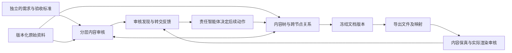

# 系统架构：版本化内容、分层审核与反馈

2026-09-30。依据用户最新讨论 `01a0ef4c-88f1-7910-b0be-9eacf35cc335`
及本会话确认更新。本文是当前架构入口，细化并覆盖054的相应旧表述。
本次更新设计，新增结构和行为尚未实现。

## 总体结构

核心是可核查的结构化内容；正文文件是某个内容版本的交付表示。先形成带依据
和版本的内容对象，再生成文档；对象可边生成、边审核、边组装，不要求全树通过
才允许导出待审稿。审核反馈驱动修订与后续组织。



箭头表示数据和反馈关系，不规定固定agent阵容或每次执行顺序。协调者维护目标/
标准并组织工作，生成者维护内容，审核者只读核查并保存审核记录。继续使用
DeepAgents原生协作；程序负责版本、权限、关系完整性和确定操作。

## 数据对象与关系

| 对象 | 必要信息 |
|---|---|
| 需求/标准版本 | ID、版本、出处、用途、范围、要求与允许限制；独立于已生成内容 |
| 内容节点版本 | 稳定ID、修订版本、类型、内容、对象/时间/单位/条件、生产者、前版 |
| 证据版本 | 来源ID/版本/hash、原文位置和相关内容；计算还关联输入、方法及结果 |
| 关系记录 | 带版本的主体—关系—客体，关系身份、记录者、出处及核实状态 |
| 文档版本 | 稳定文档ID、不可变版本ID、前版、根节点、采用的节点/关系/标准/来源版本清单 |
| 导出与渲染版本 | 对应文档版本、文件hash、模板/导出配置、渲染环境与结果hash、位置映射 |
| 审核记录/发现 | 目标及精确版本/范围、标准、证据、判定、执行状态、影响及反馈处理状态 |

内容树组织为“报告→章节→段落/表格等内容块→命题”，不是任意内容都须拆到相同
深度。表格可含行/单元格，命题可由多个位置表达。包含关系保持有序、无环；共享
命题通过引用出现于多处，不用复制事实制造多个真源。

横向关系保存支持、反驳、依赖、引用和出现位置。例如：

```text
(命题 C17@v2, 依据, 来源片段 E8@v1)
(计算 C18@v3, 依赖, 输入 C12@v2)
(命题 C17@v2, 出现在, 导出 X5@v1 的单元格锚点 A9)
```

三元组表达关联，不代替对象内容；两端指向明确版本。区分生成时采用、审核时
补充发现、尚待核实。登记支持关系不代表支持成立。横向关系不受树的单亲限制，
也不能假定无环；循环理由不能作为自身成立的证据。

语义颗粒度由命题决定，位置颗粒度由实际文档决定，两者多对多。Word批注/修订
用于展示，不是来源存储。树和关系可由新项目存储薄扩展实现，不要求新增知识
图谱服务或复用旧应用业务代码。

## 版本与修改

- 已保存版本不可覆盖；内容、依据关联、标准或结构修改形成相应新版本，保留历史。
- 文档版本冻结完整清单，不能混用不同时间的“最新节点”；复用未变节点，无需全文复制。
- 审核针对节点版本、子树快照或文档版本，绑定标准、依据及依赖。节点文本未变，
  但适用标准/依据/关系改变，也不能直接继承通过。
- 修改后标明受影响依赖、祖先组合结论及横向对象待复核，旧审核保留历史。未受
  影响证据在确认适用后显式复用，不机械重查全部，也不自动通过父节点。
- 生成者改自身成果；审核者提反馈，不覆盖内容或标准。相关agent可观察版本变化
  与反馈，由职责决定动作；可见不等于自动改写或自动重跑。

## 分层审核与覆盖责任

目标说明用途，标准说明满足条件，具体检查由agent按内容展开。设计与任务给定
正确性、完整性、一致性及实际呈现的覆盖责任；方法、深度、工具和委派自主选择。

| 层级 | 自身核查责任 |
|---|---|
| 节点 | 事实、数值、单位、适用条件、引用支持等局部关系 |
| 子树 | 一段论证、表格或章节是否成立，内部依赖与局部完整性 |
| 上层/整稿 | 对照独立需求及资料查遗漏，检查跨章节口径、汇总与明细、结论与分项关系 |

尽量局部核查，但须保留必要来源、限定和横向依赖；不足时扩大上下文。需验收的
对象有独立可追踪的审核状态；一次调用可审核子树并覆盖多对象，不必每节点调用
一次模型。尚未检查就记录尚未检查，不编造完成状态。

子节点全部通过不能推出父节点通过。父节点须有自己的组合/覆盖依据；适用于
父层同一要求的已确认子项违例也不能被平均分或“总体等级没变”掩盖。树完全
来自已生成内容时不能自证无遗漏，须对照独立需求和适用资料。标准外的新问题
交标准责任方判断，不能在审核中静默改写标准。

## 成品审核

导出后检查两件事：结构化内容是否完整准确地进入文件；真实页面是否可读。
保存内容对象到段落、单元格、图/脚注的映射，核对数值、限定、顺序和遗漏；
再观察绑定该文件hash的实际渲染，结合视觉模型与程序检查裁切、遮挡、溢出及
分页。读取OOXML或导出成功不替代成品审核。

页面问题回指内容对象或版面位置。映射不可靠时保留页面证据与定位不确定性，
不猜对应对象。手工编辑Word形成新文件版本，核对变化/映射后才能复用旧证据。
内容错误交内容生产者；导出失真或布局问题交对应实现/排版责任方处理，不为
修复版式破坏正确内容。修改后复验实际影响，分页变化时扩大页面核查范围。

## 反馈给谁、转交与停止

**现有代码：** `deep_runtime.py`把`native_review`挂在主智能体上，`review.py`
通过原生修订提示或终态消息把grader反馈送回主智能体，由其处理或安排生成者
修订。现状不是直接广播所有agent；独立SDK诊断调用也没有自动进入作者修订链。

**目标架构：** 保留主智能体接收审核反馈的入口，同时将带版本的发现和处理状态
持久化，允许项目内有权限的相关agent查询/感知并用于计划和工作。协调者组织
处理，生成者负责内容修改，审核者复验；不默认全员广播、不自动扩大权限。

三个维度分开：判定为满足/不满足/证据不足；执行为未执行/进行中/完成/受阻及
覆盖范围；转交是反馈处理状态。新记录可暂无语义判定，不能把未执行冒充已核查
的证据不足。转交和停止都不改写已有判定。

创建转交只需问题、目标及版本、已有证据和影响；**无需指定接收方、下一步或
恢复条件**。转交本身可供相关agent调整计划或接续工作。接手、动作及恢复安排
在后续处理时补充，保留处理历史；不默认转人，也不因无人接手就关闭问题。

审核产生可信反馈，生成者有据修订，复验检查问题是否消失及正确内容是否保持。
证据/能力不足或停滞时可保留未决/转交并停止当前循环；完成必须有实际覆盖和
证据。自动确定性裁决的能力范围仍需实证，不由模型自报置信度建立。

## 实现边界与验证

### Grader提示词与接口调整

保留现有的结果责任、自主策略、只读边界、三态以及证据范围要求，调整五处：

1. 审核对象从单一最终报告扩展到任务指定的节点、子树或文档，绑定明确版本及
   同版标准；仅声明实际观察和覆盖，不臆造尚未提供的结构或依赖。
2. 按层级承担责任：节点核局部关系，子树核组合，上层对照独立要求查遗漏/一致性；
   允许合并检查，但不能用子项通过或整体等级未变代替本层核验。
3. 输出对相关agent有用的发现：对象/版本、要求、观察依据、判定、交付影响及
   所需结果；作者提供的依据仍待验证，不以让作者修改或让报告通过为目标。
4. 分开三态判定、实际执行/覆盖和转交处理状态；转交无需指定接收方、下一步或
   恢复条件，已有不满足不因转交而变成未决。没有能力/证据时不强行确定裁决。
5. 成品审核分别核内容保真和实际渲染；新版本按依赖复验，记录未覆盖项；允许
   完成或保留未决停止，不能靠停止改写结论。

这些是职责和输出要求，不是固定操作顺序。系统须同时提供版本化输入、节点/
子树读取、依赖和反馈保存能力，并扩展响应契约；当前GraderResponse仍是逐标准
报告级结果，不能只改提示词就宣称支持对象级状态和转交。版本一致性、权限与
不可变保存由代码保证。本次运行提示词与响应schema均未修改。

已有DeepAgents执行、成果/标准版本、三态及DOCX导出作为基础。内容树快照、
版本化关系、对象级审核覆盖/失效传播、转交反馈消费和导出映射/成品视觉审核
是此次架构变更，不因本文完成就成为已实现能力。

下一条验证主干贯穿结构化生成、分层审核、修订、导出、保真与页面复验。包括
真实缺陷、正常内容、证据不足，以及子项通过但父层矛盾、树中遗漏必需内容、
共享依据变化、导出丢失/错位、仅创建转交、Word外部编辑等情况。以最终缺陷、
漏检/误报、改坏、未决覆盖和人工成本评价，不只追踪单个已知反例。
